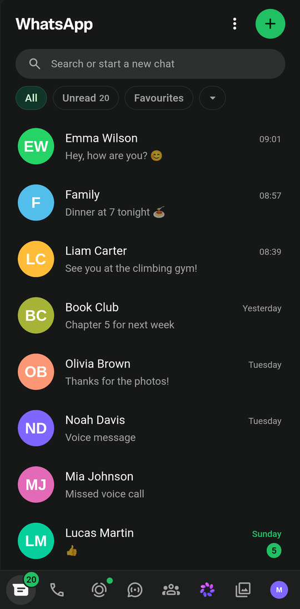
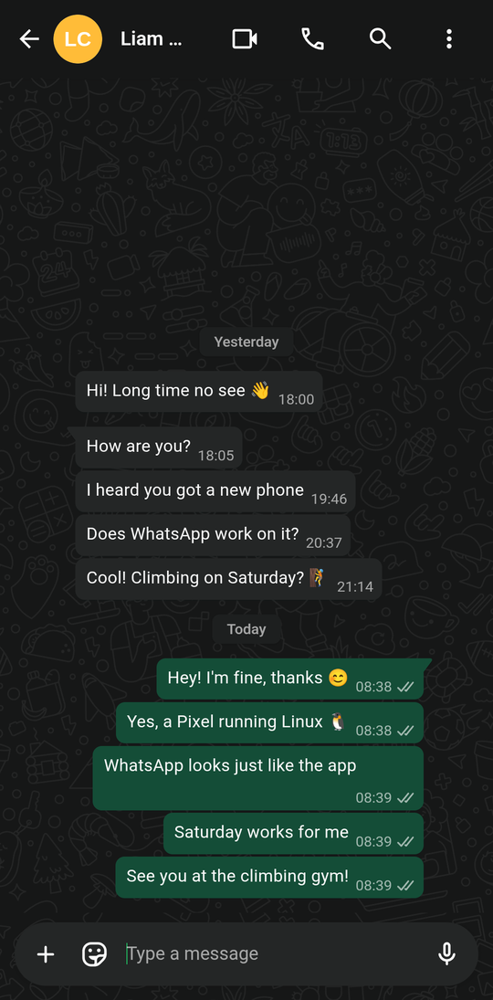
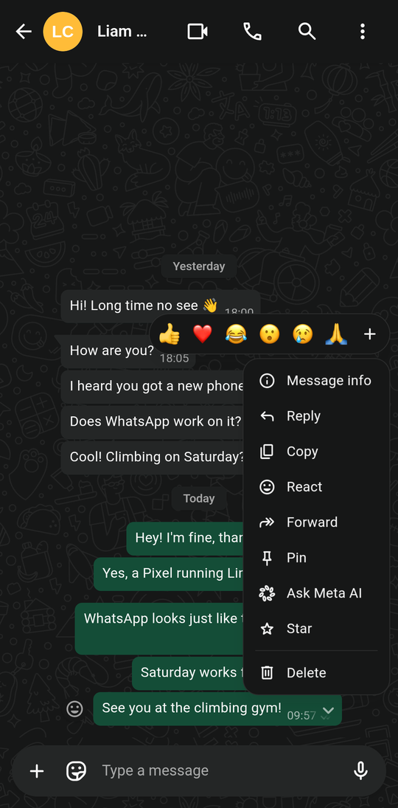

# Omarchy Mobile WhatsApp

WhatsApp Web as a phone app on [Omarchy Mobile](https://github.com/den-kloot/omarchy-mobile)
(and other Linux phones with Chromium). WhatsApp Web's desktop layout is unusable on a
phone-wide screen, and its panels and menus close whenever the on-screen keyboard folds or
unfolds. This launcher and Chromium extension fix both.

| Chats | Chat | Message menu |
| --- | --- | --- |
|  |  |  |

(Screenshots from a Pixel 9a; names, messages and pictures are made up.)

- **One pane at a time**, like the Android app: the chat list, or the open chat with a back
  arrow (the edge swipe / Escape works too). Contact info, settings and the other tabs
  open full-screen.
- **Tabs at the bottom**: WhatsApp's left icon rail becomes a bottom tab bar.
- **Panels and menus that work with the on-screen keyboard**: the emoji panel, the attach
  menu (+) and a message's menu (the arrow on a message: reply, edit, copy, …) stay open,
  and the keyboard stays up. Without this, the tap moves the focus out of the text field,
  the keyboard folds, the window grows, WhatsApp puts the focus back, the keyboard unfolds,
  and the resize closes the panel or menu again.
- **Only one WhatsApp**: starting it again (app menu, a key binding, a script) brings the open
  window to the front instead of opening a second one.
- **Follows the system theme** (light/dark).
- The emoji panel is scaled to the screen's width.

## Install

```
git clone https://github.com/den-kloot/omarchy-mobile-whatsapp
cd omarchy-mobile-whatsapp && ./install.sh
```

Needs Chromium (Google Chrome ignores `--load-extension`). `install.sh` needs no root: it
puts the extension in `~/.local/share/omarchy-mobile-whatsapp/extension`, the launcher in
`~/.local/bin/omarchy-mobile-whatsapp`, and takes over the WhatsApp entry in the app menu
(Omarchy's original is kept and comes back with `./uninstall.sh`). Close a running WhatsApp
window, then start WhatsApp from the app menu and link it with the QR code as usual.

Update: `git pull && ./install.sh`, then restart WhatsApp.
Remove: `./uninstall.sh` (keeps the login), `./uninstall.sh --purge` (deletes the profile).

## How it works

`bin/omarchy-mobile-whatsapp` starts Chromium as an app window with its own profile, so it
is its own process with its own flags:

- a **desktop user agent**: Omarchy Mobile gives Chromium an Android one, and WhatsApp Web
  answers a phone browser with "use WhatsApp on your computer";
- **the extension** (`extension/`), which lays the page out like the phone app;
- **scale 1**, so the phone-wide window is a phone-sized page.

**Only one window.** Chromium with a running profile opens every new `--app` launch as a
second window in the same process, so there would be two WhatsApp windows. So the launcher first asks Hyprland (`hyprctl clients -j`, needs `jq`)
for a window of class `chrome-web.whatsapp.com…` whose process was started with this
launcher's `--user-data-dir`, and if there is one, focuses it (Hyprland switches to its
workspace) and exits. It checks the profile, not just the class, because Omarchy's own
WhatsApp web app has the same class. `omarchy-mobile-whatsapp --new` skips the check. Without
Hyprland it simply starts Chromium.

Settings (environment): `OMW_PROFILE` (profile dir), `OMW_EXTENSION` (extension dir),
`OMW_SCALE` (default 1), `OMW_BROWSER` (default `chromium`). Extra arguments go to Chromium.

The extension has three files: `wam.css` (the layout), `wam.js` (marks WhatsApp's columns,
the back arrow, keeps taps on the emoji/attach buttons, on message buttons and in panels
and menus from taking the focus out of the text field) and `wam-main.js` (runs in the
page's own world and ignores WhatsApp's own `focus()` calls into the emoji panel, menus and
messages while a text field has the focus). It only uses WhatsApp's stable hooks (ids,
`data-testid`, ARIA roles, icon titles), no generated class names, so a WhatsApp update
rarely breaks it; if one does, please open an issue.

Not affiliated with WhatsApp or Meta.

## License

MIT
